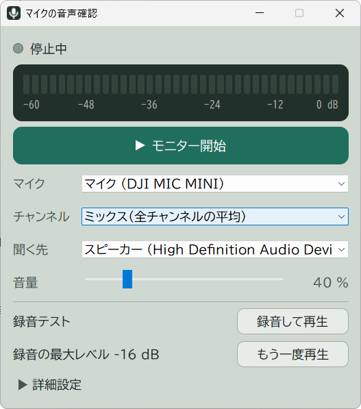

# just-mic-check

Windows11用、マイクチェック用アプリです。録音デバイスのモニターと5秒の録音再生ができます。
タスクトレイに常駐し、ウィンドウを閉じても動作を続けます。

[最新版のダウンロードはこちら](https://github.com/tvvt3aiio/just-mic-check/releases/latest)

## 使い方

1. `just-mic-check.exe` を実行します。
2. マイク(録音デバイス)と再生デバイスを選んで、「モニター開始」を押します。

## アンインストール

1. トレイのメニューで「Windowsと一緒に起動」をオフにします。
2. トレイメニューでアプリを終了します。
3. `just-mic-check.exe` と `%APPDATA%\just-mic-check` を削除します。

## マイクにアクセスできないとき

「設定 → プライバシーとセキュリティ → マイク」で、
「デスクトップ アプリがマイクにアクセスできるようにする」がオンか確認してください。

## Visual C++ ランタイムについて

実行には Microsoft Visual C++ 再頒布可能パッケージ（x64）が必要です。
`VCRUNTIME140.dll` が見つからないというエラーで起動しないときは、
[Microsoft の配布ページ](https://learn.microsoft.com/cpp/windows/latest-supported-vc-redist)からインストールしてください。

## ライセンス

[MIT License](LICENSE)

[THIRD_PARTY_LICENSES.html](THIRD_PARTY_LICENSES.html)
